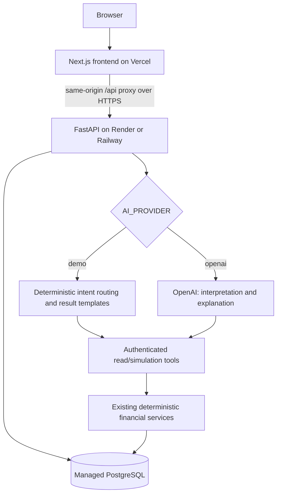

# FinPilot AI — Personal Finance Coach

FinPilot helps people understand their spending, plan goals and compare financial scenarios using verified calculations. It combines a deterministic financial engine with a conversational coach and isolated personal accounts.

**FinPilot provides educational financial guidance and simulations, not regulated financial advice. It cannot transfer money, buy investments or guarantee returns.**

## Overview

A portfolio application built with Next.js and FastAPI. Personal finances stay scoped to the signed-in user. The default Demo AI Coach uses deterministic tools without an external model, API key or AI billing. An existing optional OpenAI provider explains results through controlled tool calling.

## Problem

Balances, budgets, savings and investment illustrations can be difficult to interpret together. A conversational answer is only useful when its numbers are grounded in the person's actual data and its assumptions are explicit.

## Solution

FinPilot separates financial calculation from explanation. Services calculate cash flow, emergency reserves, goal feasibility, allocation priorities and purchase scenarios. The coach selects those services and explains their structured results; it does not replace the financial engine.

## Key Features

- Registration, login, revocable sessions and financial onboarding.
- Personal dashboard, transactions, category budgets, goals, alerts and settings.
- Financial-health components, emergency reserve coverage and monthly priorities.
- Purpose-first investment allocations and educational category comparisons.
- SIP, RD, FD and compound-growth illustrations with explicit assumptions.
- Purchase affordability and supported What-If scenarios.
- Demo AI Coach, bounded conversation follow-ups and read-only synthetic demo account.
- Optional backend-only OpenAI integration with a controlled tool allowlist.

## Architecture



The recommended public setup proxies `/api/*` through the frontend. This keeps the browser session cookie first-party even when Vercel and the API host have different domains. Direct API origins are also configurable; cookie requirements differ. See [DEPLOYMENT_GUIDE.md](DEPLOYMENT_GUIDE.md).

## Tech Stack

| Layer | Technology |
| --- | --- |
| Frontend | Next.js, React, TypeScript, Tailwind, Recharts |
| Backend | Python, FastAPI, Pydantic |
| Persistence | SQLAlchemy, Alembic; SQLite locally, PostgreSQL in production |
| Authentication | Argon2 passwords, opaque hashed server-side sessions |
| Optional AI | Official OpenAI Python SDK, Responses API function calling |
| Verification | pytest, TypeScript, ESLint, Next.js build, optional Playwright |

## Financial Intelligence Engine

Money uses Decimal arithmetic and database `NUMERIC(14,2)` fields. Existing services calculate recorded savings, monthly surplus, safety buffers, investable surplus, emergency coverage, health components and goal contributions. These concepts remain distinct; surplus is not automatically an investment recommendation.

Investment categories are educational. SIP is an investment method, not an asset class. Projections use supplied assumptions and exclude factors such as taxes and fees where indicated; market-linked returns are not guaranteed.

## AI Coach Architecture

The authenticated endpoint is `POST /api/ai/chat`. Clients provide a message and optional owned conversation UUID, never an identity to read. `GET /api/ai/config` returns provider metadata for the UI.

Tools cover summary, spending, budgets, health, emergency reserves, saved/unsaved goal analysis, priorities, monthly plans, investment allocation/categories, SIP/RD/FD, affordability and supported scenarios. Tool execution injects the current user's identity and has no arbitrary SQL, payment, trade or data-deletion capabilities.

OpenAI mode preserves the existing Responses tool loop, structured replies, token/round limits, timeouts and safe upstream-error handling. It sends bounded conversation text and relevant aggregates, not an unrestricted transaction feed. `store=False` disables Responses storage; it does not establish zero provider retention. Prompt and numeric/pattern filters reduce hallucination risk but cannot prove every explanation is semantically correct.

## Demo AI Mode

`AI_PROVIDER=demo` is the safe default. It uses authenticated users' real FinPilot data and fixed templates over deterministic tools. There is no OpenAI client creation or external AI API call, even if a key is present. This mode works locally and in the proposed cloud architecture. The UI identifies it as **Demo AI Coach**.

Try:

- `Where am I overspending?`
- `Why is my financial health score low?`
- `What should I prioritize this month?`
- `How is my emergency fund?`
- `How are my goals doing?`
- `What investment categories could fit my goals?`
- `Can I afford an ₹80,000 phone?` Then supply the missing date/payment details, such as `Cash, today.`
- After purchase analysis: `What if I wait six months?`
- `Simulate SIP of ₹1,000 for 12 months at an assumed 5% annual rate.`
- `What if my monthly income increases by ₹5,000?`

The local router supports a bounded set of phrases and clarification flows, not arbitrary natural-language reasoning. See [PHASE5_DEMO_MODE_REPORT.md](PHASE5_DEMO_MODE_REPORT.md) for limits. The optional synthetic Aarav demo **account** is separate from the AI **provider**; registered accounts receive no synthetic transactions or goals.

## Authentication & Multi-user Security

Passwords use Argon2. Session cookies are HttpOnly, host-only and backed by expiring, hashed database tokens. Production cookies are Secure; local HTTP keeps working. Logout invalidates the server session. Financial routes derive identity from the cookie, and legacy ID routes authorize supplied IDs against that identity.

CORS allows one configured frontend origin with credentials, not a wildcard. Mutation requests require `X-FinPilot-Request: 1`; present Origin headers must match configured origins. Host headers cannot create a trusted CSRF origin. All API responses are marked `no-store`.

The recommended proxy architecture uses `SameSite=lax`. Direct cross-site API calls require `SameSite=none` with HTTPS/Secure and can still fail under browser third-party-cookie restrictions. Do not weaken cookies or CSRF checks to bypass that behavior; use the frontend proxy instead.

Login/registration have persistent hashed throttle keys. Production also applies bounded process-local IP/group limits, request-body caps, and existing per-user AI limits. These are lightweight portfolio protections, not distributed DDoS defenses. Run one backend worker until conversation/rate storage is shared. Configure trusted proxy IPs deliberately; do not blindly trust client forwarding headers.

## Screenshots

Place reviewed, synthetic-data screenshots here before publishing:

- Dashboard and financial health
- Goals and investment allocations
- Affordability and What-If comparison
- Demo AI Coach and mobile layout

Do not include real financial records, credentials or browser cookies in screenshots.

## Local Setup

Requirements: Python 3.12, Node.js compatible with the installed Next.js version, and npm. PostgreSQL/Docker are optional for local SQLite use.

```powershell
python -m venv .venv
.venv/Scripts/python -m pip install -r requirements.txt
# Copy only if .env does not already exist; preserve existing configuration.
Copy-Item .env.example .env
.venv/Scripts/python -m scripts.initialize_database
.venv/Scripts/python -m uvicorn app.main:app --host 127.0.0.1 --port 8000
```

In a second terminal:

```powershell
cd frontend
npm ci
# Copy only if frontend/.env.local does not already exist.
Copy-Item .env.example .env.local
npm run dev
```

Open `http://localhost:3000`. Use the same hostname for the local UI/API so cookies work across their ports. Create an account and complete onboarding. Leave `AI_PROVIDER=demo`; no AI key is necessary. An existing database should be backed up before migrations.

Optional read-only account data is an explicit operator action:

```powershell
.venv/Scripts/python -m scripts.initialize_database --demo
```

The seeder refuses to convert an existing non-demo account into the synthetic demo account. It is never invoked automatically by production startup. Without a seeded demo account, registration works normally and Explore Demo reports that it is unavailable.

For local PostgreSQL, review `.env` and then run `docker compose up --build`. The Compose database/API bind to loopback, persist PostgreSQL in a named volume and initialize the shared catalog without automatic demo-user seeding. Its default `postgres` credentials are disposable local-development values only. Use separate strong managed credentials in production. Do not run `docker compose down -v` against data you want to keep.

## Environment Variables

| Variable | Location | Purpose |
| --- | --- | --- |
| `APP_ENV` | Backend | `development` locally; `production` enables strict DB/HTTPS checks, Secure cookies, safe error logging and request limits |
| `DATABASE_URL` | Backend only | SQLite locally; managed `postgresql+psycopg://...` in production; provider `postgres://`/`postgresql://` URLs are normalized |
| `FRONTEND_URL` | Backend | One exact frontend origin, no path or wildcard |
| `BACKEND_URL` | Backend | Optional canonical backend origin for CSRF validation |
| `BACKEND_URL` | Frontend server/build | Backend origin for same-origin `/api/*` rewrites; never a database URL or a credential-bearing URL |
| `NEXT_PUBLIC_API_URL` | Frontend public/build | Direct API origin locally; leave unset/empty for the recommended production proxy |
| `SESSION_COOKIE_NAME` | Both | Same cookie name; default `finpilot_session` |
| `SESSION_COOKIE_SAMESITE` | Backend | `lax` recommended; `none` only for intentional direct cross-site production HTTPS |
| `SESSION_TTL_SECONDS` | Backend | Session expiry; default 86400 |
| `HOST`, `PORT` | Backend | Local bind / hosting port; production entry point binds `0.0.0.0` and reads `PORT` |
| `AI_PROVIDER` | Backend | `demo` default; `openai` explicitly enables the existing model integration |
| `OPENAI_API_KEY` | Backend secret | Optional; required only for `openai` mode |
| `OPENAI_MODEL` | Backend | Existing configurable model, unused in demo mode |
| `AI_TIMEOUT_SECONDS`, `AI_MAX_OUTPUT_TOKENS`, `AI_MAX_TOOL_ROUNDS` | Backend | Existing OpenAI cost/timeout bounds |
| `MAX_REQUEST_BYTES` | Backend | Request-body limit; default 65536 |
| `SAFETY_BUFFER_RATE`, `SAFETY_BUFFER_MINIMUM` | Backend | Existing deterministic planning configuration |
| `FORWARDED_ALLOW_IPS` | Backend runtime | Explicit trusted reverse-proxy IPs/CIDRs when needed; do not set `*` blindly |
| `FINPILOT_TEST_DATABASE_URL` | Tests only | Optional PostgreSQL URL for disposable-schema integration tests |

`.env`, local databases, dumps, build output, node_modules and virtual environments are ignored. Never expose a database URL, session credential or OpenAI key through `NEXT_PUBLIC_*`.

## Database Migrations

```powershell
.venv/Scripts/python -m alembic upgrade head
# Recommended first initialization: migrations plus idempotent shared catalog.
.venv/Scripts/python -m scripts.initialize_database
```

Production requires PostgreSQL. Use the managed service's documented TLS settings and URL-encode special characters in credentials. Apply migrations once as an explicit release step, not concurrently from multiple app workers. Normal API startup does not create tables or seed accounts.

Models retain timezone-aware timestamps, Decimal-compatible money columns, ownership foreign keys/cascades, unique per-user profile/preferences and period budgets, and ownership/date indexes. PostgreSQL DDL compilation tests do not replace a real PostgreSQL migration/runtime test. See [POSTGRESQL_VERIFICATION.md](POSTGRESQL_VERIFICATION.md) for historical evidence and [PHASE6_PRODUCTION_READINESS_REPORT.md](PHASE6_PRODUCTION_READINESS_REPORT.md) for this phase's exact verified scope.

## Testing

```powershell
.venv/Scripts/python -m pytest -q
.venv/Scripts/python -m scripts.scan_repository_secrets
cd frontend
npm run typecheck
npm run lint
npm run build
cd ..
.venv/Scripts/python -m scripts.verify_phase5_assets
```

For real PostgreSQL verification, set `FINPILOT_TEST_DATABASE_URL` to a disposable test database with schema-creation permission before pytest. Each test creates a unique schema and cleans up that schema; never use a production account/database for these tests. When unset, real PostgreSQL tests skip rather than report a false pass. Optional browser checks use the installed Playwright runtime and Chrome.

`/health` checks the app without DB access. `/ready` checks database connectivity with a lightweight query, without returning connection details. Migrations/catalog initialization still need to be completed separately.

## Deployment Architecture

Prepare Vercel for `frontend/`, Render or Railway for the FastAPI backend, and a managed PostgreSQL database. The portable backend command is `python -m app.serve`; the Dockerfile uses a non-root user and no development reload. One worker matches the current in-memory coach/rate design.

**Nothing has been deployed automatically.** Follow [DEPLOYMENT_GUIDE.md](DEPLOYMENT_GUIDE.md) for exact manual configuration, migrations, cookie/CORS choices and rollback considerations. Use [PRODUCTION_SMOKE_TEST_CHECKLIST.md](PRODUCTION_SMOKE_TEST_CHECKLIST.md) after deployment. Review current hosting terms/prices; no free-tier or trial availability is assumed.

## Responsible AI / Financial Safety

FinPilot provides educational guidance and simulations, not regulated financial advice. Never enter bank passwords, UPI PINs, OTPs, CVVs or full card credentials. There are no money-movement or trade-execution tools and no named-stock/fund recommendations. Investment results are illustrations, not promises. Consider professional advice for major financial decisions.

Demo mode keeps questions/results in the application's own bounded process memory. OpenAI mode involves external processing of relevant aggregates and bounded text; review provider data controls before enabling it. Keep SDK/HTTP/SQL debug logging disabled in production. Application production errors omit raw exceptions and access logs are disabled by the production entry point; hosting proxy logs require a separate review.

## Future Improvements

- Shared expiring conversation storage and distributed rate controls before horizontal scaling.
- Live-host/browser and managed-PostgreSQL verification after the manual deployment.
- Broader deterministic intent coverage and better input clarification.
- Accessibility and regression automation across additional devices.
- Further model evaluations if the optional paid AI provider is enabled.

Future work requires a separate decision; Phase 6 stops at deployment preparation.
